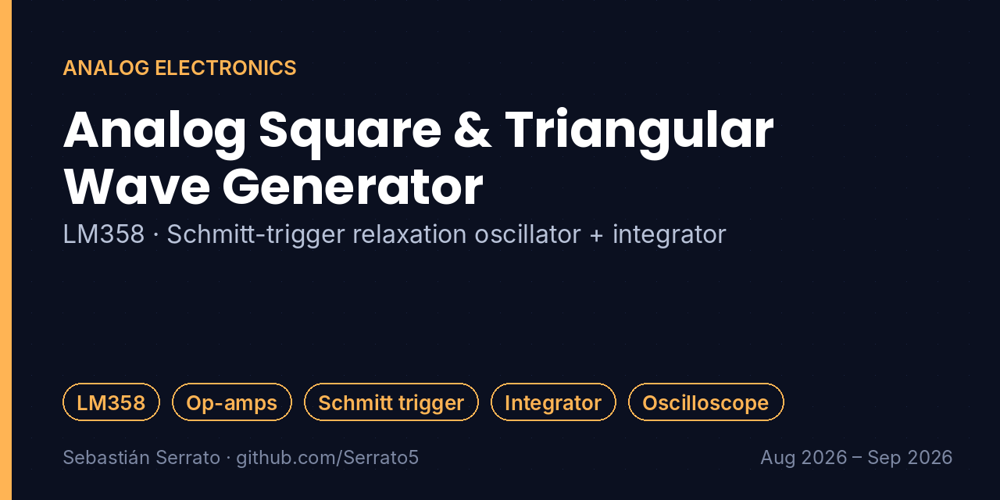

# Analog Square & Triangular Wave Generator

**LM358 · Schmitt-trigger relaxation oscillator + integrator**

`LM358` `Op-amps` `Schmitt trigger` `Integrator` `Oscilloscope` `LTspice / Proteus / Multisim`

## Overview

Design and validation of a two-stage analog signal generator based on the LM358 dual operational amplifier: a relaxation oscillator (Schmitt trigger) produces a square wave, and an analog integrator turns it into a triangular wave.

## Key features

- **Circuit design:** Relaxation oscillator (Schmitt trigger) for the square wave, coupled to an analog integrator for triangular-wave synthesis.
- **Calculation and tuning:** Selection of passive components (R, C) to set the oscillation frequency and adjust the output amplitude to the design parameters.
- **Laboratory validation:** Real-time characterization with an oscilloscope: rise time, duty cycle and linearity of the triangular ramp.
- **Simulation:** Preliminary simulation (Proteus / LTspice / Multisim) to compare theoretical behavior with real component tolerances.

## How it works

## What I learned

- How positive feedback and hysteresis create oscillation.
- Choosing R and C to hit a target frequency and amplitude.
- Comparing simulation against real tolerances on the bench.

## Project context

| | |
|---|---|
| Context | Universidad Surcolombiana |
| Dates | Aug 2026 – Sep 2026 |
| Area | Analog Electronics |

## Resumen en español

Generador analógico de dos etapas con el amplificador operacional LM358: un oscilador de relajación (Schmitt trigger) genera la onda cuadrada y un integrador la convierte en triangular. Se calcularon R y C para la frecuencia y amplitud, se simuló y se caracterizó con osciloscopio.

---

**About this repository:** the original source code and design files of this project were not preserved. This repository documents what was built, how it works and what I learned, based on my project records. It does not contain reconstructed code.

**Sobre este repositorio:** el código y los archivos originales de este proyecto no se conservaron. Aquí se documenta qué se construyó, cómo funciona y qué aprendí, sin código reconstruido.

**Author:** Sebastián Serrato Ramírez · Electronic Engineering student, Universidad Surcolombiana (Neiva, Colombia) · [LinkedIn](https://www.linkedin.com/in/sebaserrato) · [More projects](https://github.com/Serrato5)
